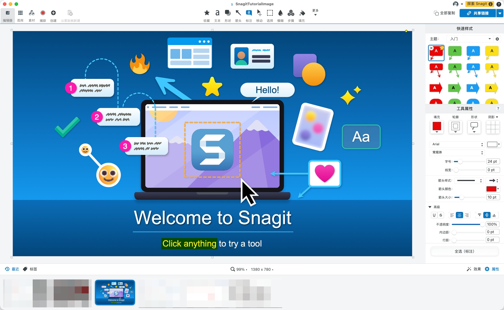

# Snagit for Mac 简体中文汉化包

想让 Mac 上的 Snagit 显示中文？如果你已经安装了 **Snagit 2027.0.1**，下载下面的汉化包就可以了。不用打开终端，也不用输入命令。

**[下载中文汉化包（ZIP）](https://github.com/letgoing/snagit-zh-CN/releases/download/v2027.0.1/Snagit-2027.0.1-macOS-zh-Hans.zip)** · [查看已发布的版本](https://github.com/letgoing/snagit-zh-CN/releases)

## 第一次安装

1. **看一眼版本号。** 打开 Snagit，在屏幕左上角点「Snagit → About Snagit（关于 Snagit）」。确认是 **2027.0.1** 再使用上面的包；版本不同，请不要直接覆盖。
2. **保存并退出。** 保存正在编辑的图片，结束录屏，退出 Snagit。如果屏幕顶部的菜单栏里还有 Snagit 图标，也从那里退出捕获助手。
3. **解压后，先打开 `00-先读我.txt`。** 它会告诉你在访达里点哪里、把文件夹复制到哪里。按 **01 主程序 → 02 效果组件 → 03 捕获助手** 的顺序操作；如果目标位置已经有同名文件夹，先按说明改名留一份备份。
4. **重新打开 Snagit。** 看看顶部工具栏和右侧的「快速样式」，再点一下「捕获」看看小窗。少数文字和产品名称仍可能显示英文。

还没下载也可以[先看看完整的安装步骤](docs/手动汉化说明.txt)。

## 汉化后的样子

## 常见问题

**编辑器已经是中文了，为什么捕获小窗还是英文？**

小窗由菜单栏里的捕获助手单独运行。先确认安装时没有漏掉「03 捕获助手」，再退出菜单栏里的 Snagit，重新打开试试。

**升级 Snagit 后，又变回英文了怎么办？**

软件更新可能会覆盖翻译。先到[版本下载页](https://github.com/letgoing/snagit-zh-CN/releases)找与新版匹配的汉化包。如果你以前用过一键工具，保存文件、结束录屏后，也可以双击 `一键重新汉化.command` 再试一次。这个工具需要 Python 3，可从[完整工具包](https://github.com/letgoing/snagit-zh-CN/archive/refs/heads/main.zip)获取；上面的手动安装不需要它。

**想换回原来的界面怎么办？**

退出 Snagit 和捕获助手，然后按[说明最后的「如何恢复」](docs/手动汉化说明.txt)移走新加的中文文件夹；如果留了备份，把备份改回原名即可。如果恢复后仍打不开，请重新安装官方原版，不必关闭 Mac 的安全保护。

这是非官方中文翻译，不包含 Snagit 软件或许可证，与 TechSmith 无隶属关系。

## 自愿打赏

汉化包可以免费下载和使用。如果它帮到了你，欢迎扫码支持后续维护。

